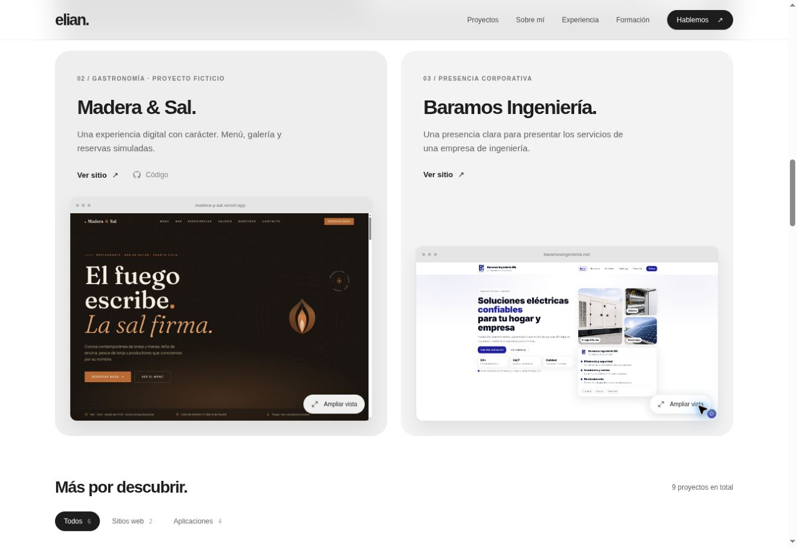

# Portafolio de Elian Rodríguez

Portafolio personal construido con React y Vite, con diseño en blanco y negro, proyectos destacados y capturas ampliables.

## Desarrollo

```bash
npm ci
npm run dev
```

## Compilación

```bash
npm run build
npm run preview
```

## Contenido

- `src/data/projects.js`: proyectos, tecnologías y enlaces.
- `src/components/Projects.jsx`: proyectos destacados, filtros y vista ampliada de capturas.
- `src/components/Certifications.jsx`: formación agrupada por área.
- `src/components/About.jsx` y `Experience.jsx`: perfil, educación y experiencia.
- `src/components/Contact.jsx`: enlaces de contacto y copia de correo.
- `public/projects/`: capturas reales de los proyectos.
- `public/cv.pdf`: CV descargable.
- `src/index.css`: diseño responsive y preferencias de movimiento reducido.

Las capturas se muestran en su proporción original. La vista ampliada se cierra con el botón, con Escape o al pulsar el fondo.

## Vista del diseño



## Calidad y publicación

- Node.js 24 y `npm ci` para instalar las versiones del lockfile.
- `npm run lint` y `npm run build` se ejecutan también en GitHub Actions.
- `node_modules/`, `dist/` y los archivos de entorno locales no se versionan.
- Los casos destacados se mantienen en `src/data/caseStudies.js`. Añadir roles, contexto de cliente y métricas solo cuando estén confirmados.
- GymAI usa un esquema funcional identificado como tal hasta disponer de capturas reales.
- Al confirmar el dominio de producción, usar URLs absolutas para `og:image` y `twitter:image` en `index.html` y añadir `og:url` y un enlace canonical. No se presupone un dominio de despliegue.
- La imagen social está en `public/social-preview.png` y el favicon en `public/favicon.svg`.

Comprobación manual: recorrer el sitio con teclado, abrir y cerrar capturas con Escape, filtrar proyectos, desplegar casos y formación, revisar menú móvil y preferencia de movimiento reducido. Revisar los enlaces externos y el CV antes de publicar.
